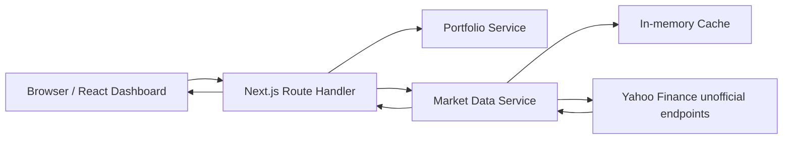
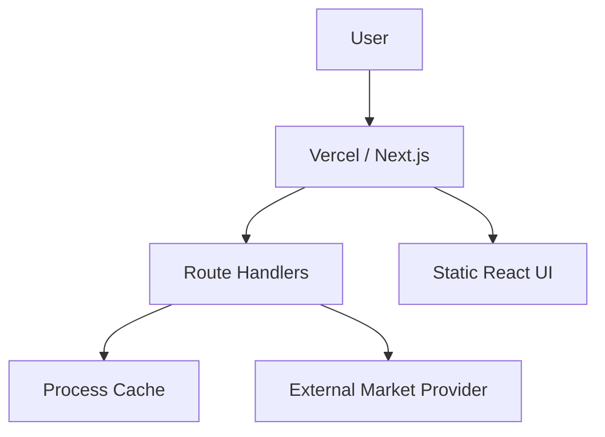

# Architecture

## Overview

## Frontend

The dashboard is a small client application responsible for presentation, sorting, refresh orchestration, responsive states, and derived display values. Business calculations live in `app/lib/calculations` rather than JSX.

## Backend

Next.js Route Handlers expose `/api/portfolio` and `/api/market-data`. The browser never calls Yahoo directly. Provider-specific behavior is isolated behind `MarketDataProvider`.

## Data flow

1. Portfolio route reads the normalized workbook-derived JSON.
2. The browser receives validated holdings and their provider lookup symbols.
3. The market route receives a unique symbol list.
4. The market service checks its server cache and in-flight request map.
5. Missing symbols are requested from Yahoo's unofficial endpoints.
6. Results are cached and returned to the browser.
7. The client combines live data with the workbook's last-known values for graceful degradation.

## Caching

The default cache TTL is 30 seconds. The UI refreshes every 15 seconds, so consecutive refreshes normally reuse the server cache rather than producing another external request. In-memory caching is suitable for a single process; Redis should replace it for a multi-instance deployment.

## Error handling

Provider timeouts, rate limits and server errors are retried with a small exponential delay. Provider failures return row-level errors and the UI falls back to workbook values instead of failing the complete dashboard.

## Deployment architecture

For horizontal scaling, move the process cache to Redis and add centralized observability.
